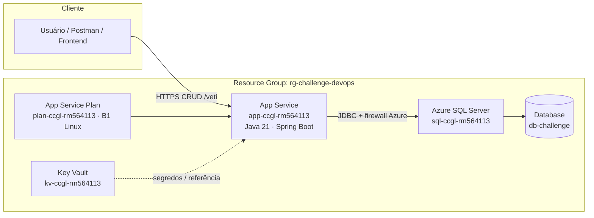

# Challenge 2026 — DevOps & Cloud (Sprint 3)

**Time CCGL** · Turma **2TDSPW** · Região Azure: **chilecentral**

API Spring Boot hospedada na Azure (**Opção B — PaaS**): **App Service (Web App)** + **Azure SQL Database**, provisionados exclusivamente via **Azure CLI**.

---

## Integrantes

| RM | Nome | Turma |
|---|---|---|
| 564113 | *(preencher nome completo)* | 2TDSPW |
| — | *(preencher)* | 2TDSPW |
| — | *(preencher)* | 2TDSPW |
| — | *(preencher)* | 2TDSPW |

> Substitua os placeholders pelos nomes oficiais da equipe antes da entrega.

---

## 1. Descrição da solução

A solução entrega uma **API REST Java (Spring Boot)** na nuvem Azure, com persistência em **Azure SQL Database (PaaS)** e exposição via **Azure App Service**.

Na prática, o sistema permite:

- **CRUD completo** (inclusão, alteração, exclusão e consulta) sobre **pelo menos duas tabelas relacionadas**
- Persistência real de dados na nuvem (não apenas em localhost)
- Autenticação via JWT (segredo armazenado no **Azure Key Vault** e injetado como App Setting)
- Validação rápida da infraestrutura (health check e status dos recursos) pelos scripts deste repositório

Este repositório concentra a **infraestrutura como scripts** (create / test / delete) e o **passo a passo de deploy e homologação** exigidos pelo Challenge.

---

## 2. Benefícios para o negócio

| Benefício | Impacto prático |
|---|---|
| **Disponibilidade na nuvem** | A API fica acessível 24/7 via HTTPS, sem depender de máquina local |
| **Banco gerenciado (PaaS)** | Backup, patch e alta disponibilidade tratados pelo Azure SQL — menos operação manual |
| **Segurança de credenciais** | Senhas e JWT ficam no Key Vault / App Settings, fora do código-fonte |
| **Provisionamento repetível** | Scripts Azure CLI reduzem erro humano e permitem recriar o ambiente em minutos |
| **Custo controlado** | Camada SQL Basic + App Service Plan B1 — custo estimado ~US$ 18/mês |
| **Rastreabilidade acadêmica** | Clone → scripts → deploy → CRUD + SELECT no banco, alinhado ao vídeo demonstrativo |

---

## 3. Arquitetura (Opção B — App Service + Azure SQL)

> **Regra do Challenge:** não misturar com containers (ACR/ACI). App e banco são **somente PaaS**.

### Diagrama de arquitetura



### Fluxo técnico

1. O operador faz login no Azure e executa `azure_create_infra.sh`.
2. O script cria Resource Group, SQL Server + Database, regras de firewall, Key Vault, App Service Plan e Web App.
3. Credenciais e connection string são gravadas no Key Vault e injetadas como **App Settings** do Web App.
4. O JAR Spring Boot é publicado no App Service (`az webapp deploy --type jar`).
5. Requisições HTTPS chegam ao Web App; a API persiste dados no Azure SQL.
6. Homologação: `GET /veti/health` + CRUD em Tutor/Pet + `SELECT` no Azure SQL (`sqlcmd`).

### Recursos Azure

| Recurso | Nome | Função |
|---|---|---|
| Resource Group | `rg-challenge-devops` | Agrupa e facilita exclusão total |
| Azure SQL Server | `sql-ccgl-rm564113` | Servidor lógico PaaS |
| Azure SQL Database | `db-challenge` | Banco relacional (Basic) |
| Key Vault | `kv-ccgl-rm564113` | Segredos (JDBC, usuário, senha, JWT) |
| App Service Plan | `plan-ccgl-rm564113` | Hospedagem B1 Linux |
| Web App | `app-ccgl-rm564113` | Runtime Java 21 + JAR Spring Boot |

**URL da aplicação:** `https://app-ccgl-rm564113.azurewebsites.net`  
**API (context-path):** `https://app-ccgl-rm564113.azurewebsites.net/veti`  
**Código da API:** [challenge-2026-java-spint1](https://github.com/Challenge-2025-Equipe-07/challenge-2026-java-spint1) (perfil Spring `azure` + driver `mssql-jdbc`)

---

## 4. Pré-requisitos

- Conta Azure com assinatura ativa
- [Azure CLI](https://learn.microsoft.com/cli/azure/install-azure-cli) (`az --version`)
- Java 21 + Maven Wrapper do projeto da aplicação (`./mvnw`)
- `curl` e `python3` (scripts de teste)
- `sqlcmd` (opcional, para o `SELECT` de persistência no vídeo)
- Repositório da API [challenge-2026-java-spint1](https://github.com/Challenge-2025-Equipe-07/challenge-2026-java-spint1) com as alterações Azure (driver SQL Server + perfil `azure`)

---

## 5. How-To — Deploy e teste (passo a passo)

### 5.1 Clone do repositório

```bash
git clone <URL_DESTE_REPOSITORIO>
cd 2tdspw-challange-devops-sem2
chmod +x azure_*.sh
```

### 5.2 Build da aplicação (Veti)

Não publique o `Dockerfile` / `docker-compose` na Azure (Opção B = JAR no App Service + Azure SQL). Postgres local via Compose continua válido só em desenvolvimento.

```bash
git clone https://github.com/Challenge-2025-Equipe-07/challenge-2026-java-spint1.git
cd challenge-2026-java-spint1
# Confirme pom.xml com mssql-jdbc e src/main/resources/application-azure.properties
# (cópia Azure-ready local: ../challenge-2026-java-spint1-azure — faça push para o GitHub da API antes do vídeo)
./mvnw clean package -DskipTests
# Resultado esperado: target/veti-0.0.1-SNAPSHOT.jar
```

### 5.3 Provisionar infraestrutura + deploy

```bash
export SQL_ADMIN_PASSWORD='SuaSenhaForte!123'   # opcional; senão o script pede interativamente
./azure_create_infra.sh
```

O script executa, via Azure CLI:

1. Login (se necessário)
2. Registro dos providers (`Microsoft.Web`, `Microsoft.Sql`, `Microsoft.KeyVault`)
3. Resource Group
4. Azure SQL Server + Database + firewall
5. Key Vault + secrets
6. App Service Plan + Web App + App Settings (`SPRING_PROFILES_ACTIVE=azure`, `DB_URL` / `DB_USER` / `DB_PASSWORD`)
7. Deploy do JAR (se existir em `target/*.jar`)

Se o JAR não estiver neste repositório no momento do create:

```bash
az webapp deploy \
  --resource-group rg-challenge-devops \
  --name app-ccgl-rm564113 \
  --src-path /caminho/para/target/veti-0.0.1-SNAPSHOT.jar \
  --type jar
```

Ou: `JAR_PATH=/caminho/para/target/veti-0.0.1-SNAPSHOT.jar ./azure_create_infra.sh`

Logs de subida: `az webapp log tail -g rg-challenge-devops -n app-ccgl-rm564113`

### 5.4 Validar infraestrutura

```bash
./azure_test_infra.sh
```

Verifica: Web App `Running`, SQL Database `Online` e health check HTTP em `/veti/health`.

### 5.5 Testar CRUD na nuvem (Tutor + Pet)

POST/PUT/DELETE exigem JWT. GET é público. Script automatizado:

```bash
export SQL_ADMIN_PASSWORD='SuaSenhaForte!123'   # para o SELECT no final
./azure_test_crud.sh
```

Fluxo manual (equivalente):

```bash
BASE=https://app-ccgl-rm564113.azurewebsites.net/veti

curl -s "$BASE/health"

curl -s -X POST "$BASE/auth/register" -H 'Content-Type: application/json' \
  -d '{"email":"vet@ccgl.com","password":"SenhaForte!123","role":"ADMIN"}'

TOKEN=$(curl -s -X POST "$BASE/auth/login" -H 'Content-Type: application/json' \
  -d '{"email":"vet@ccgl.com","password":"SenhaForte!123"}' \
  | python3 -c 'import json,sys; v=json.load(sys.stdin); print(v["token"] if isinstance(v, dict) else v)')

curl -s -X POST "$BASE/tutores" -H "Authorization: Bearer $TOKEN" -H 'Content-Type: application/json' \
  -d '{"name":"Ana Silva","email":"ana@ccgl.com","phone":"11999999999","cpf":"12345678901"}'
curl -s -X POST "$BASE/tutores" -H "Authorization: Bearer $TOKEN" -H 'Content-Type: application/json' \
  -d '{"name":"Bruno Souza","email":"bruno@ccgl.com","phone":"11888888888","cpf":"98765432100"}'

curl -s -X POST "$BASE/pets" -H "Authorization: Bearer $TOKEN" -H 'Content-Type: application/json' \
  -d '{"name":"Rex","raca":"LABRADOR_RETRIEVER","peso":28.5,"idade":4,"castrado":true,"idTutor":1}'
curl -s -X POST "$BASE/pets" -H "Authorization: Bearer $TOKEN" -H 'Content-Type: application/json' \
  -d '{"name":"Mimi","raca":"PERSIAN","peso":4.2,"idade":2,"castrado":false,"idTutor":2}'

curl -s "$BASE/tutores"
curl -s -X PUT "$BASE/tutores/1" -H "Authorization: Bearer $TOKEN" -H 'Content-Type: application/json' \
  -d '{"name":"Ana Silva Costa","email":"ana@ccgl.com","phone":"11777777777","cpf":"12345678901"}'
curl -s -X DELETE "$BASE/pets/2" -H "Authorization: Bearer $TOKEN"
```

Swagger: `https://app-ccgl-rm564113.azurewebsites.net/veti/swagger-ui.html`

### 5.6 Provar persistência no banco (obrigatório no vídeo)

Não existe `az sql query`. Use `sqlcmd` (ou o Query Editor no Portal):

```bash
sqlcmd -S sql-ccgl-rm564113.database.windows.net -d db-challenge \
  -U sqladmin -P "$SQL_ADMIN_PASSWORD" -N -C \
  -Q "SELECT TOP 10 * FROM TB_TUTOR; SELECT TOP 10 * FROM TB_PET;"
```

### 5.7 Logs em tempo real (troubleshooting)

```bash
az webapp log tail \
  --resource-group rg-challenge-devops \
  --name app-ccgl-rm564113
```

### 5.8 Limpeza total

```bash
./azure_delete_infra.sh
```

Remove o Resource Group e faz purge do Key Vault (libera o nome do vault).

---

## 6. Scripts do repositório

| Script | Função |
|---|---|
| `azure_create_infra.sh` | Cria toda a infra PaaS e faz deploy do JAR |
| `azure_test_infra.sh` | Valida Web App, SQL e `GET /veti/health` |
| `azure_test_crud.sh` | Register/login JWT + CRUD Tutor/Pet (≥ 2 linhas) + `sqlcmd` |
| `azure_delete_infra.sh` | Remove Resource Group + purge do Key Vault |
| `guia_deploy_azure.md` | Referência detalhada dos comandos `az` |

Todos os recursos Azure deste Challenge são criados **apenas via Azure CLI** (nunca só pelo Portal).

---

## 7. Desenho de arquitetura (artefato visual)

O diagrama Mermaid da **seção 3** é o desenho oficial de arquitetura deste repositório (fluxos, recursos Azure e descrição técnica).

Para o vídeo / PDF de entrega, exporte o diagrama (GitHub renderiza Mermaid no README) ou use o portal Azure → Resource Group `rg-challenge-devops` para evidenciar os recursos criados.

---

## 8. Entregáveis Sprint 3 (checklist)

- [x] README com **descrição da solução** e **benefícios de negócio**
- [x] Scripts Azure CLI de provisionamento no repositório
- [x] How-To de deploy e teste (clone → create → test → CRUD → SELECT)
- [x] Desenho de arquitetura (diagrama + fluxo)
- [ ] CRUD completo na nuvem com ≥ 2 tabelas relacionadas e ≥ 2 linhas reais
- [ ] Vídeo (≥ 720p, voz, sem legendas): scripts CLI → clone → deploy → CRUD com persistência
- [ ] Professor com acesso admin/Basic no Azure Boards (Compliance)

---

## 9. Links da entrega

| Item | Link |
|---|---|
| Repositório GitHub | *(colar URL)* |
| Vídeo demonstrativo | *(colar URL — acesso liberado ao professor)* |
| Azure Boards (backlog) | *(colar URL)* |
| Aplicação em produção | https://app-ccgl-rm564113.azurewebsites.net |

---

## 10. Segurança

- **Não** commitar senhas, connection strings ou tokens no código.
- Use variáveis de ambiente / Key Vault / App Settings.
- Após o setup, restrinja a regra de firewall `AllowAllSetup` (ver `guia_deploy_azure.md`).
