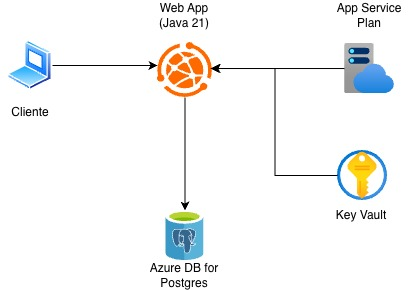

# Challenge 2026 — DevOps & Cloud (Sprint 3)

**Time CCGL** · Turma **2TDSPW** · Região Azure: **chilecentral**

Repositório de **infraestrutura e deploy** da API **Veti** (Spring Boot / Java 21) na Azure.

**Opção B — PaaS (sem containers):** [Azure App Service](https://learn.microsoft.com/azure/app-service/) (Web App) + [Azure Database for PostgreSQL Flexible Server](https://learn.microsoft.com/azure/postgresql/). Todos os recursos são criados por **Azure CLI** (`azure_*.sh`). Não misturar com ACR/ACI.

---

## Integrantes

| RM | Nome | Turma |
|---|---|---|
| 564113 | Camilo Micheletto da Silva | 2TDSPW |
| 564982 | Carlos André Silva | 2TDSPW |
| 562700 | Guilherme Ribeiro da Costa | 2TDSPW |
| 566376 | Laura Lopes Cruz | 2TDSPW |

---

## 1. O que a solução faz

**Veti** é uma API REST de clínica veterinária. Na nuvem ela persiste cadastros reais e expõe CRUD HTTP autenticado.

Este repositório **não** é o código-fonte da API. Ele provisiona o ambiente Azure, clona [challenge-2026-java-spint1](https://github.com/Challenge-2025-Equipe-07/challenge-2026-java-spint1), gera o JAR e publica no App Service.

Na prática:

- **CRUD completo** (inclusão, alteração, exclusão e consulta) em **duas tabelas relacionadas:** `TB_TUTOR` e `TB_PET` (pet aponta para tutor)
- Pelo menos **2 linhas reais** em cada fluxo de homologação
- Persistência no PostgreSQL PaaS (não em localhost)
- Autenticação JWT (`POST /veti/auth/login` devolve o token em texto)
- Scripts de create / test / CRUD / delete para o vídeo e a correção
- DDL documentado em [`script_bd.sql`](script_bd.sql) (tabelas, colunas, PKs, FKs e `COMMENT ON`)

**Aplicação:** https://app-ccgl-rm564113.azurewebsites.net  
**API (context-path `/veti`):** https://app-ccgl-rm564113.azurewebsites.net/veti  
**Swagger:** https://app-ccgl-rm564113.azurewebsites.net/veti/swagger-ui.html

A Veti **não** tem endpoint `/health`. O probe usado nos testes é `GET /veti/tutores` (público, JSON).

---

## 2. Benefícios para o negócio

| Benefício | Impacto |
|---|---|
| **Clínica acessível na nuvem** | Tutores e pets ficam disponíveis via HTTPS, sem depender do notebook do aluno |
| **Banco gerenciado (PaaS)** | Patch, backup e SSL ficam a cargo do Azure Database for PostgreSQL |
| **Credenciais fora do Git** | Senha JDBC e JWT vão para Key Vault e App Settings — não no código |
| **Ambiente repetível** | Um script recria Resource Group, banco, app e deploy em minutos |
| **Custo de laboratório** | PostgreSQL Burstable `Standard_B1ms` + App Service Plan **B1** Linux |
| **Evidência de persistência** | CRUD na API + `SELECT` em `TB_TUTOR` / `TB_PET` no servidor Azure |

---

## 3. Arquitetura

A API já usa o driver PostgreSQL e as variáveis `DB_URL`, `DB_USER` e `DB_PASSWORD` (as mesmas do `docker-compose` local). Na Azure o motor é o **Flexible Server**, não um container. O JAR sobe no App Service Linux (Java 21). `SPRING_JPA_HIBERNATE_DDL_AUTO=update` no App Service evita o `create-drop` do `application.properties` local.



### Fluxo

1. `./azure_create_infra.sh` — login, providers, Resource Group, PostgreSQL + database + firewall, Key Vault, App Service Plan, Web App, App Settings.
2. O mesmo script clona a API, seleciona **Java 21**, roda `./mvnw package` e faz `az webapp deploy --type jar`.
3. Requisições HTTPS chegam ao Web App; a API grava no PostgreSQL (`sslmode=require`).
4. Homologação: `./azure_test_infra.sh` → curls de `./azure_test_crud.sh` → `SELECT` nas tabelas.

O Key Vault **guarda** JDBC, usuário, senha e JWT. Em runtime a Web App lê **App Settings** (cópia feita no create), não Key Vault References.

### Recursos

| Recurso | Nome | Função |
|---|---|---|
| Resource Group | `rg-challenge-devops` | Agrupa e apaga tudo de uma vez |
| PostgreSQL Flexible Server | `pg-ccgl-rm564113` | PaaS Burstable `Standard_B1ms` (menor SKU do Flexible Server) |
| Database | `db-challenge` | Banco da Veti |
| Key Vault | `kv-ccgl-rm564113` | Segredos do setup |
| App Service Plan | `plan-ccgl-rm564113` | Hospedagem B1 Linux |
| Web App | `app-ccgl-rm564113` | Runtime Java 21 + JAR |

Admin do Postgres: usuário `ccgl`. Host: `pg-ccgl-rm564113.postgres.database.azure.com:5432`.

---

## 4. Pré-requisitos

- Conta Azure com assinatura ativa
- [Azure CLI](https://learn.microsoft.com/cli/azure/install-azure-cli) (`az login` já feito ou o script pede)
- **Java 21** no PATH ou detectável (`/usr/libexec/java_home -v 21` no macOS) — o create seleciona sozinho
- `git`, `curl`, `python3`
- Senha do admin Postgres (exportar ou digitar quando o script pedir)

---

## 5. How-To — deploy e teste

Fluxo que o professor deve reproduzir no vídeo (clone deste repo → scripts → CRUD → `SELECT`).

### 5.1 Clone deste repositório

```bash
git clone <URL_DESTE_REPOSITORIO>
cd 2tdspw-challange-devops-sem2
chmod +x azure_*.sh
```

Não é necessário clonar a API Java à mão. Não publique `Dockerfile` / `docker-compose` na Azure.

### 5.2 Provisionar + build + deploy

```bash
export PG_ADMIN_PASSWORD='SuaSenhaForte!123'
./azure_create_infra.sh
```

Passos do script: login → providers (`Microsoft.Web`, `Microsoft.DBforPostgreSQL`, `Microsoft.KeyVault`) → Resource Group → PostgreSQL + `db-challenge` + firewall → Key Vault → Plan B1 + Web App → App Settings (`DB_URL` / `DB_USER` / `DB_PASSWORD`, JWT, placeholders Google) → `git clone` + `./mvnw package` + deploy do JAR.

O Flexible Server pode levar vários minutos até `Ready`. O script espera esse estado antes de criar o database.

Logs da app:

```bash
az webapp log tail -g rg-challenge-devops -n app-ccgl-rm564113
```

### 5.3 Validar infraestrutura

```bash
./azure_test_infra.sh
```

Confere Web App `Running`, PostgreSQL `Ready` e `GET /veti/tutores` em JSON. Se a página for *Hey, Java developers!*, o JAR ainda não subiu.

### 5.4 CRUD na nuvem (Tutor + Pet)

`GET` é público. `POST` / `PUT` / `DELETE` exigem JWT. O login devolve o token em texto (`eyJ...`), não `{"token":"..."}`.

```bash
./azure_test_crud.sh
```

O script **não dispara** o CRUD: imprime curls prontos para copiar e colar (URL completa, sem variáveis). Depois do login, substitua `COLE_O_JWT_AQUI` pelo JWT. Se o POST não devolver id `1`/`2`, ajuste o número no `curl`.

### 5.5 Persistência no banco (vídeo)

```bash
az postgres flexible-server execute \
  --name pg-ccgl-rm564113 \
  --admin-user ccgl \
  --admin-password "$PG_ADMIN_PASSWORD" \
  --database-name db-challenge \
  --querytext 'SELECT * FROM "TB_TUTOR" LIMIT 10; SELECT * FROM "TB_PET" LIMIT 10;'
```

As aspas em `"TB_TUTOR"` / `"TB_PET"` são obrigatórias (Hibernate criou os nomes em maiúsculas). Cliente gráfico (DBeaver): host `pg-ccgl-rm564113.postgres.database.azure.com`, porta `5432`, database `db-challenge`, user `ccgl`, SSL `require`.

### 5.6 Limpeza

```bash
./azure_delete_infra.sh
```

Remove o Resource Group e faz **purge** do Key Vault (sem o purge, o nome `kv-ccgl-rm564113` fica preso em soft-delete). A exclusão do grupo é assíncrona: `az group show -n rg-challenge-devops`.

Comandos `az` avulsos: [`guia_deploy_azure.md`](guia_deploy_azure.md).

---

## 6. Scripts

| Arquivo | Função |
|---|---|
| `azure_create_infra.sh` | Cria a PaaS, clona a API, build e deploy do JAR |
| `azure_test_infra.sh` | Web App + PostgreSQL + `GET /veti/tutores` |
| `azure_test_crud.sh` | Imprime curls de JWT + CRUD Tutor/Pet para copiar e colar |
| `azure_delete_infra.sh` | Resource Group + purge do Key Vault |
| `script_bd.sql` | DDL PostgreSQL (tabelas, colunas, PK/FK, comentários) |
| `guia_deploy_azure.md` | Referência dos comandos `az` |

Nenhum recurso deste Challenge é criado só pelo Portal.

---

## 7. Entrega Sprint 3

- [x] README com descrição da solução e benefícios de negócio
- [x] Scripts Azure CLI no repositório
- [x] How-To (clone → create → test → CRUD → SELECT)
- [x] Desenho de arquitetura (diagrama + fluxo + recursos)
- [x] DDL em `script_bd.sql` (estrutura + comentários)
- [ ] CRUD na nuvem evidenciado no vídeo (≥ 2 tabelas relacionadas, ≥ 2 linhas)
- [ ] Vídeo (≥ 720p, voz, sem legendas): CLI → clone deste repo → deploy → CRUD + persistência
- [ ] Professor com acesso **Basic** e admin no Azure Boards (Compliance)

| Item | Link |
|---|---|
| Repositório GitHub | *(colar URL deste repositório)* |
| Vídeo demonstrativo | *(colar URL — acesso liberado ao professor)* |
| Azure Boards | *(colar URL)* |
| Aplicação | https://app-ccgl-rm564113.azurewebsites.net |
| Código da API | https://github.com/Challenge-2025-Equipe-07/challenge-2026-java-spint1 |

---

## 8. Segurança

- Não commitar senhas, connection strings ou JWT. Use `PG_ADMIN_PASSWORD` no ambiente.
- O create **imprime** a URI JDBC no terminal — não cole isso no README nem no commit.
- `GOOGLE_CLIENT_ID` / `GOOGLE_CLIENT_SECRET` no App Service são placeholders para a Veti subir; login Google não faz parte do CRUD do Challenge.
- A regra `AllowAllSetup` (0.0.0.0–255.255.255.255) existe só para setup e `SELECT` no vídeo. Depois, restrinja ao IP da máquina (ver `guia_deploy_azure.md`).
- Após `azure_delete_infra.sh`, espere o Resource Group sumir antes de rodar o create de novo.
