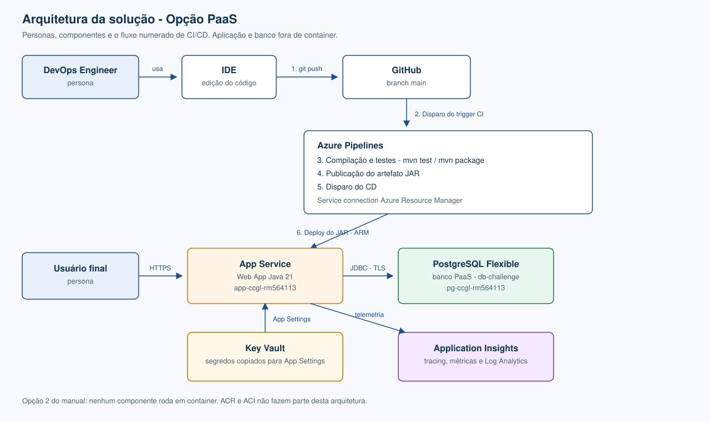

# Challenge 2026 — DevOps & Cloud (Sprints 3 e 4)

**Time CCGL** · Turma **2TDSPW** · Região Azure: **chilecentral**

Repositório de **infraestrutura e deploy** da API **Veti** (Spring Boot / Java 21) na Azure.

**Opção 2 — PaaS (sem containers):** [Azure App Service](https://learn.microsoft.com/azure/app-service/) (Web App) + [Azure Database for PostgreSQL Flexible Server](https://learn.microsoft.com/azure/postgresql/). Todos os recursos são criados por **Azure CLI** (`azure_*.sh`). Não misturar com ACR/ACI.

A esteira avaliada está no repositório da API, na `main`: [`azure-pipelines.yml`](https://github.com/Challenge-2025-Equipe-07/challenge-2026-java-spint1/blob/main/azure-pipelines.yml). Ela roda `./mvnw test` (23 testes) e publica o JAR em `app-ccgl-rm564113`. O [`azure-pipelines.yml`](azure-pipelines.yml) deste repositório não deve ser registrado no Azure DevOps: ele clonaria a API de novo e faria um segundo deploy do mesmo App Service.

---

## Integrantes

| RM | Nome | Turma |
|---|---|---|
| 564113 | Camilo Micheletto da Silva | 2TDSPW |
| 564982 | Carlos André Silva | 2TDSPW |
| 562700 | Guilherme Ribeiro da Costa | 2TDSPW |
| 566376 | Laura Lopes Cruz | 2TDSPW |

---

## 1. O que a solução faz

**Veti** é uma API REST de clínica veterinária. Na nuvem ela persiste cadastros reais e expõe CRUD HTTP autenticado.

Este repositório **não** é o código-fonte da API. Ele provisiona o ambiente Azure, clona [challenge-2026-java-spint1](https://github.com/Challenge-2025-Equipe-07/challenge-2026-java-spint1), gera o JAR e publica no App Service.

Na prática:

- **CRUD completo** (inclusão, alteração, exclusão e consulta) em **duas tabelas relacionadas:** `TB_TUTOR` e `TB_PET` (pet aponta para tutor)
- Pelo menos **2 linhas reais** em cada fluxo de homologação
- Persistência no PostgreSQL PaaS (não em localhost)
- Autenticação JWT (`POST /veti/auth/login` devolve o token em texto)
- Scripts de create / test / CRUD / delete para o vídeo e a correção
- DDL documentado em [`script_bd.sql`](script_bd.sql) (tabelas, colunas, PKs, FKs e `COMMENT ON`)

**Aplicação:** https://app-ccgl-rm564113.azurewebsites.net  
**API (context-path `/veti`):** https://app-ccgl-rm564113.azurewebsites.net/veti  
**Swagger:** https://app-ccgl-rm564113.azurewebsites.net/veti/swagger-ui.html

A `main` da API expõe `GET /health` (alias do Actuator) e `GET /veti/actuator/health`, com checagem do PostgreSQL. O probe de negócio continua em `GET /veti/tutores` (público, JSON).

O create liga **Application Insights** no Web App (agente Java 3.x). A `main` também grava log JSON com correlation id e exporta tracing e métricas HTTP.

---

## 2. Benefícios para o negócio

| Benefício | Impacto |
|---|---|
| **Clínica acessível na nuvem** | Tutores e pets ficam disponíveis via HTTPS, sem depender do notebook do aluno |
| **Banco gerenciado (PaaS)** | Patch, backup e SSL ficam a cargo do Azure Database for PostgreSQL |
| **Credenciais fora do Git** | Senha JDBC e JWT vão para Key Vault e App Settings — não no código |
| **Ambiente repetível** | Um script recria Resource Group, banco, app e deploy em minutos |
| **Custo de laboratório** | PostgreSQL Burstable `Standard_B1ms` + App Service Plan **B1** Linux |
| **Evidência de persistência** | CRUD na API + `SELECT` em `TB_TUTOR` / `TB_PET` no servidor Azure |
| **Telemetria sem alterar o JAR** | Application Insights e Log Analytics sobem pelo script, antes do Java instrumentar o código |

---

## 3. Arquitetura

A API já usa o driver PostgreSQL e as variáveis `DB_URL`, `DB_USER` e `DB_PASSWORD` (as mesmas do `docker-compose` local). Na Azure o motor é o **Flexible Server**, não um container. O JAR sobe no App Service Linux (Java 21). `SPRING_JPA_HIBERNATE_DDL_AUTO=update` no App Service evita o `create-drop` do `application.properties` local.



O diagrama acima é a arquitetura da solução, com as duas personas e os seis passos do CI/CD.

1. Push para o GitHub (`git push` na branch `main`)
2. Disparo do trigger de CI
3. Compilação e testes (`mvn test` / `mvn package`)
4. Publicação do artefato JAR
5. Disparo do CD, autenticado pela service connection ARM
6. Deploy no App Service

Em runtime o usuário chama a API por HTTPS, a Web App grava no PostgreSQL por JDBC com TLS, lê segredos pelos App Settings e envia telemetria ao Application Insights.

### Fluxo do script de infra

1. `./azure_create_infra.sh` — login, providers, Resource Group, PostgreSQL + database + firewall, Key Vault, App Service Plan, Web App, Log Analytics, Application Insights, diagnostic settings e App Settings.
2. O mesmo script clona a API, seleciona **Java 21**, roda `./mvnw package -DskipTests` e faz `az webapp deploy --type jar`.
3. Requisições HTTPS chegam ao Web App; a API grava no PostgreSQL (`sslmode=require`). O agente Java 3.x do App Service envia telemetria ao Application Insights.
4. Homologação: `./azure_test_infra.sh` → `./azure_test_crud.sh` ou `./tests/run_newman.sh` → `SELECT` nas tabelas.

O Key Vault **guarda** JDBC, usuário, senha, JWT e a connection string do Application Insights. Em runtime a Web App lê **App Settings** (cópia feita no create), não Key Vault References.

### Recursos

| Recurso | Nome | Função |
|---|---|---|
| Resource Group | `rg-challenge-devops` | Agrupa e apaga tudo de uma vez |
| PostgreSQL Flexible Server | `pg-ccgl-rm564113` | PaaS Burstable `Standard_B1ms` (menor SKU do Flexible Server) |
| Database | `db-challenge` | Banco da Veti |
| Key Vault | `kv-ccgl-rm564113` | Segredos do setup, inclusive a connection string do Application Insights |
| App Service Plan | `plan-ccgl-rm564113` | Hospedagem B1 Linux |
| Web App | `app-ccgl-rm564113` | Runtime Java 21 + JAR |
| Log Analytics | `law-ccgl-rm564113` | Destino dos diagnostic settings (HTTP, console, métricas). Se `chilecentral` recusar o workspace, o script cria em `eastus2` |
| Application Insights | `appi-ccgl-rm564113` | Tracing e métricas do agente Java, sem mudar o repositório da API |

Admin do Postgres: usuário `ccgl`. Host: `pg-ccgl-rm564113.postgres.database.azure.com:5432`.

---

## 4. Pré-requisitos

- Conta Azure com assinatura ativa
- [Azure CLI](https://learn.microsoft.com/cli/azure/install-azure-cli) (`az login` já feito ou o script pede)
- **Java 21** no PATH ou detectável (`/usr/libexec/java_home -v 21` no macOS) — o create seleciona sozinho
- `git`, `curl`, `python3`
- Senha do admin Postgres (exportar ou digitar quando o script pedir)

---

## 5. How-To — deploy e teste

Fluxo que o professor deve reproduzir no vídeo (clone deste repo → scripts → CRUD → `SELECT`).

### 5.1 Clone deste repositório

```bash
git clone <URL_DESTE_REPOSITORIO>
cd 2tdspw-challange-devops-sem2
chmod +x azure_*.sh
```

Não é necessário clonar a API Java à mão. Não publique `Dockerfile` / `docker-compose` na Azure.

### 5.2 Provisionar + build + deploy

```bash
export PG_ADMIN_PASSWORD='SuaSenhaForte!123'
./azure_create_infra.sh
```

Passos do script: login → providers (`Microsoft.Web`, `Microsoft.DBforPostgreSQL`, `Microsoft.KeyVault`, `Microsoft.Insights`, `Microsoft.OperationalInsights`) → Resource Group → PostgreSQL + `db-challenge` + firewall → Key Vault → Plan B1 + Web App → Log Analytics + Application Insights → App Settings (`DB_URL` / `DB_USER` / `DB_PASSWORD`, JWT, placeholders Google, `APPLICATIONINSIGHTS_CONNECTION_STRING`, `ApplicationInsightsAgent_EXTENSION_VERSION=~3`) → diagnostic settings → `git clone` + `./mvnw package -DskipTests` + deploy do JAR.

O create pode ser executado de novo: plan, Web App, firewall, workspace e Application Insights que já existem são reaproveitados. O `package` segue com `-DskipTests` porque o Java atual não compila `mvn test`.

O Flexible Server pode levar vários minutos até `Ready`. O script espera esse estado antes de criar o database.

Logs da app:

```bash
az webapp log tail -g rg-challenge-devops -n app-ccgl-rm564113
```

### 5.3 Validar infraestrutura

```bash
./azure_test_infra.sh
```

Confere Web App `Running`, PostgreSQL `Ready` e `GET /veti/tutores` em JSON. Se a página for *Hey, Java developers!*, o JAR ainda não subiu.

### 5.4 CRUD na nuvem

`GET` é público. `POST` / `PUT` / `DELETE` exigem JWT.

```bash
./azure_test_crud.sh
```

O script **executa** o CRUD via HTTP (2 tutores, 2 pets, 2 veterinários, 2 consultas — altera e apaga uma) e no final só faz **SELECT** no Postgres para provar que os curls gravaram.

### 5.5 Persistência no banco (vídeo)

```bash
az postgres flexible-server execute \
  --name pg-ccgl-rm564113 \
  --admin-user ccgl \
  --admin-password "$PG_ADMIN_PASSWORD" \
  --database-name db-challenge \
  --querytext 'SELECT * FROM tb_tutor LIMIT 10; SELECT * FROM tb_pet LIMIT 10;'
```

Hibernate no PostgreSQL cria tabelas **minúsculas** (`tb_tutor`, `tb_pet`). `"TB_TUTOR"` entre aspas não existe. Beekeeper: `SELECT * FROM tb_tutor;`.

**Beekeeper Studio — Import from URL:** cole só a URI `postgres://...` impressa no final do `azure_create_infra.sh` (não a linha JDBC). Depois do import, em SSL escolha **Trust the server**. Azure exige TLS; o import liga SSL mas deixa a verificação de certificado ligada, e a conexão cai.

Se o import falhar, preencha na mão:

| Campo | Valor |
|---|---|
| Connection type | PostgreSQL |
| Host | `pg-ccgl-rm564113.postgres.database.azure.com` |
| Port | `5432` |
| User | `ccgl` |
| Default database | `db-challenge` |
| SSL | Enable SSL → **Trust the server** |

### 5.6 Limpeza

```bash
./azure_delete_infra.sh
```

Remove o Resource Group (Web App, plan, PostgreSQL, Application Insights, Log Analytics) e faz **purge** do Key Vault (sem o purge, o nome `kv-ccgl-rm564113` fica preso em soft-delete). A exclusão do grupo é assíncrona: `az group show -n rg-challenge-devops`.

### 5.7 Testes de API (Newman)

Cinco casos contra a API que já está no ar: `GET /tutores`, login JWT, criar tutor, alterar tutor e criar pet. Exige Node.js (`npx`).

```bash
./tests/run_newman.sh
```

A coleção está em [`tests/veti.postman_collection.json`](tests/veti.postman_collection.json). Outro host: `BASE_URL=https://app-ccgl-rm564113.azurewebsites.net/veti ./tests/run_newman.sh`.

### 5.8 Pipeline CI/CD

A pipeline que o Azure DevOps importa é a da API, na `main`:

https://github.com/Challenge-2025-Equipe-07/challenge-2026-java-spint1/blob/main/azure-pipelines.yml

- Trigger em `main` e em pull request.
- Stage CI: `./mvnw test` (23 testes AAA) e publicação do JAR.
- Stage CD (só na `main`, se o CI passou): service connection ARM `azure-rm-challenge`, `healthCheckPath` em `/health` e `az webapp deploy --type jar` em `app-ccgl-rm564113`.
- Variável vazia de banco, JWT ou Application Insights não apaga o App Setting que o `azure_create_infra.sh` já gravou.

O [`azure-pipelines.yml`](azure-pipelines.yml) deste repositório fica só como referência. Não registrar esse arquivo.

---

## 6. Scripts

| Arquivo | Função |
|---|---|
| `azure_create_infra.sh` | Cria a PaaS (incluindo Application Insights), clona a API, build e deploy do JAR |
| `azure_test_infra.sh` | Web App + PostgreSQL + Application Insights + probe `GET /veti/tutores` |
| `azure_test_crud.sh` | Executa CRUD HTTP (Tutor/Pet/Consulta/Veterinário) e SELECT de conferência |
| `azure_delete_infra.sh` | Resource Group + purge do Key Vault |
| `azure-pipelines.yml` | Referência local. A pipeline avaliada é a do repositório Java, na `main`. Não registrar este arquivo |
| `tests/run_newman.sh` | Cinco casos Newman/Postman na API publicada |
| `script_bd.sql` | DDL PostgreSQL (tabelas, colunas, PK/FK, comentários) |
| `arquitetura-cicd.svg` | Diagrama da arquitetura e do fluxo CI/CD |

---

## 7. Repositório da API

O fonte continua em [challenge-2026-java-spint1](https://github.com/Challenge-2025-Equipe-07/challenge-2026-java-spint1), na `main` (merge da `feat/sprint-4`, commit `dac0a02`). Este repositório não copia esse código. O `azure_create_infra.sh` clona essa `main`.

| Requisito | Situação na `main` |
|---|---|
| `GET /health` com API e PostgreSQL | Actuator em `/veti/actuator/health` e alias público `GET /health` |
| Log estruturado com Information, Warning, Error e correlation id | Console JSON (Logstash) e `X-Correlation-Id` |
| Suíte AAA via `mvn test` | `./mvnw test` — 23 testes |
| Tracing entre camadas | OpenTelemetry / Micrometer na API, mais o agente do Application Insights |
| Scripts Azure CLI | Ficam neste repositório. Código, DDL, diagrama e `azure-pipelines.yml` ficam no repositório da API |

---

## 8. Azure DevOps, vídeo e PDF

Isto não é criado pelos scripts. Falta fazer na organização do time, com o nome do professor na descrição:

- Projeto `Sprint 4 – Azure DevOps`, processo **Scrum**, descrição `Projeto para entrega da Sprint 4 do professor <Nome do Professor>`, integrantes no formato `<RM> - <Nome> - <Turma>`.
- Professor com acesso **Basic** e permissão de administração em Boards, Repos e Pipelines.
- Boards: épico, feature, PBI com descrição e critérios Given-When-Then, prioridade, esforço, dependências, roadmap e tasks da sprint.
- Test Plan com casos manuais do core da Veti.
- Service connection **Azure Resource Manager** chamada `azure-rm-challenge`. Importar o `azure-pipelines.yml` da `main` do repositório Java, não o deste repositório.
- PDF só com nomes, RMs, turma e os links do GitHub, do YouTube e do Azure DevOps.
- Vídeo em 720p, com voz de todos os integrantes, `git clone`, scripts, pipeline ao vivo e CRUD com `SELECT` no PostgreSQL.
